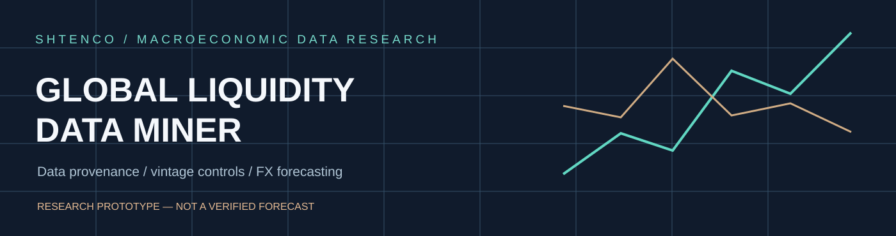
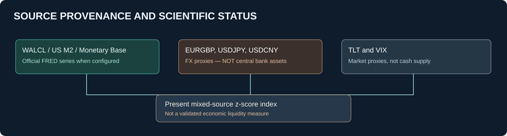
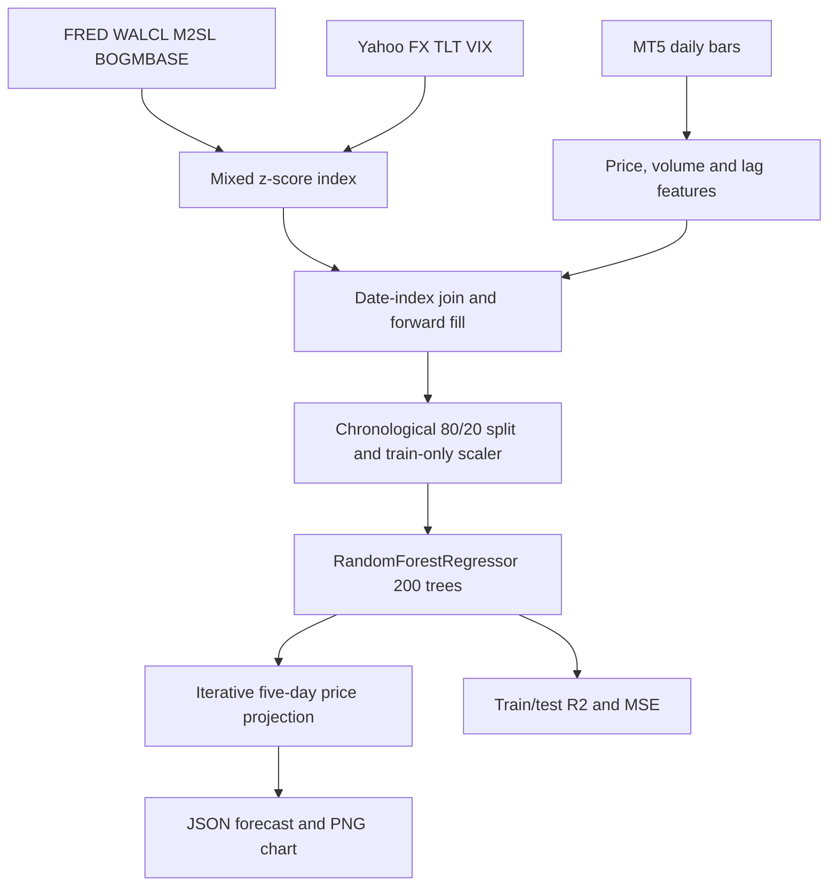
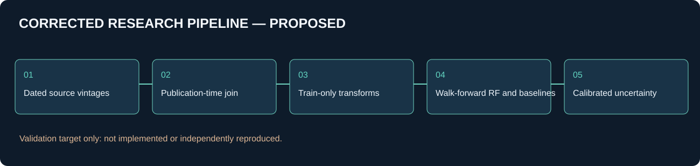

<div align="center">



**GLOBAL LIQUIDITY DATA MINER**

Исследование мировых денежных индикаторов, происхождения данных, причинной синхронизации и прогнозирования валютных доходностей.

[Назначение](#назначение) · [Исходники](#проверенная-архитектура) · [Источники](#аудит-источников) · [Формулы](#формулы-и-математические-ограничения) · [ML](#прогнозная-модель-и-ошибки-валидации) · [Запуск](#запуск) · [План](#критерии-научного-развития)

</div>

> **Научный статус: исследовательский прототип.** Код соединяет FRED, Yahoo Finance, MetaTrader 5, композитный индекс и Random Forest. Однако часть входов названа балансами центральных банков ошибочно, имеются утечки статистической информации и неполный расчёт прогнозной неопределённости. Название проекта не доказывает существование экономически корректного глобального индекса ликвидности.

## Назначение

Движение валютных курсов зависит в том числе от процентных ставок, политики центральных банков, валютного риска и глобальных финансовых условий. Для количественного анализа важно объединять **наблюдаемые макроэкономические величины** и рыночные ряды без подмены одних другими. Этот репозиторий представляет заготовку исследовательского конвейера: получение внешних рядов, вычисление композитного индикатора, построение признаков для FX и обучение модели прогнозирования.

Потенциальные пользователи будущей валидированной версии — экономические аналитики, исследовательские подразделения, quant-команды, разработчики мониторинга данных и лаборатории машинного обучения. Текущий код нельзя предлагать как проверенный прогнозный сервис или торговый сигнал с доказанной доходностью.

## Проверенная архитектура





Код состоит из двух классов:

| Класс | Функции | Фактическое назначение |
|:--|:--|:--|
| `GlobalLiquidityMiner` | `fetch_central_bank_balance_sheets`, `fetch_money_supply_data`, `calculate_global_liquidity_index` | Загрузка рядов и их агрегирование |
| `ForexLiquidityForecaster` | `fetch_forex_data`, `prepare_features_for_prediction` | MT5 и инженерия признаков |
| `ForexLiquidityForecaster` | `train_prediction_model` | Random Forest с одним 80/20 split |
| `ForexLiquidityForecaster` | `get_price_forecast`, `visualize_price_forecasts` | Рекурсивные прогнозы и построение графика |
| `ForexLiquidityForecaster` | `run_full_analysis_with_predictions` | Последовательный оркестратор анализа трёх пар |

Есть отдельная техническая проблема: в конце оркестратора вызываются `visualize_central_bank_balance_sheets()` и `visualize_global_liquidity_index()`, однако **соответствующих методов в `GlobalLiquidityMiner` в данном исходнике нет**. При достижении этих вызовов выполнение завершится исключением, а не подтверждённым полным графическим отчётом.

## Аудит источников

| Источник кода | Тикер / идентификатор | Что действительно измеряет | Методологический статус |
|:--|:--|:--|:--|
| FRED | `WALCL` | Активы Federal Reserve | Официальная серия, но нужны единицы и винтаж публикации |
| FRED | `M2SL` | Денежный агрегат M2 США | Официальная денежная статистика |
| FRED | `BOGMBASE` | Денежная база США | Официальная денежная статистика |
| Yahoo Finance | `EURGBP=X` | Валютный курс EUR/GBP | **Не баланс ЕЦБ** |
| Yahoo Finance | `USDJPY=X` | Валютный курс USD/JPY | **Не баланс Банка Японии** |
| Yahoo Finance | `USDCNY=X` | Валютный курс USD/CNY | **Не баланс Народного банка Китая** |
| Yahoo Finance | `TLT` | Цена ETF долгосрочных казначейских облигаций США | Рыночный индикатор, не денежный агрегат |
| Yahoo Finance | `^VIX` | Индекс ожидаемой волатильности американского фондового рынка | Индикатор риска, не объём ликвидности |
| MetaTrader 5 | `EURUSD`, `GBPUSD`, `USDJPY` | История FX OHLC и tick volume | Брокерозависимый рыночный источник |

В коде валютные курсы умножаются на произвольные коэффициенты `1000000` и `10000000`, затем именуются `balance_sheet`. Такое умножение **не превращает FX-курс в активы центрального банка**. Институт, единица измерения, изменение стоимости активов и денежная политика остаются неидентифицированными.

## Формулы и математические ограничения

### Нормализация отдельных рядов

Исходная реализация использует z-score по *всей доступной истории* каждого индикатора:

$$
z_{j,t}=\frac{x_{j,t}-\bar{x}_{j,\mathrm{all}}}{s_{j,\mathrm{all}}}.
$$

Здесь $j$ — исходный ряд, $t$ — дата наблюдения. Сама формула математически стандартна, но выбор средних и стандартных отклонений по всему диапазону данных **неприемлем в ретроспективном прогнозном эксперименте**, потому что статистики зависят от будущих наблюдений. Для walk-forward параметры должны оцениваться на доступном к дате решения обучающем интервале.

Для конкретного набора доступных записей индекс вычисляется как

$$
L_t=\frac{1}{|J_t|}\sum_{j\in J_t} z_{j,t},
$$

где $J_t$ — множество серий, реально имеющих значение на дате $t$. Это **равновесное среднее наблюдаемых нормированных рядов**, не экономически взвешенный индекс международной ликвидности.

Если в разные дни состав $J_t$ меняется, значение $L_t$ может меняться даже без реального экономического сдвига. Скрипт объединяет данные по **точному совпадению дат**, так что ежедневные рыночные ряды и еженедельные/ежемесячные макроиндикаторы не получают корректной модели доступности на дату.

### Динамика рынка и целевая переменная

Модель рассчитывает простую доходность:

$$
r_t=\frac{P_t}{P_{t-1}}-1,
\qquad
y_t=\frac{P_{t+1}}{P_t}-1.
$$

Это корректные определения простых доходностей при $P_t>0$. Однако целевая величина $y_t$ становится наблюдаемой только после закрытия следующего бара. Для честной валидации важно определить точный момент доступности признаков за $t$ и исключить публикации макростатистики, появившиеся позже.

### Прирост ликвидности: деление на ноль

Программная операция `liquidity_index.pct_change()` соответствует

$$
\Delta^{rel}L_t=\frac{L_t-L_{t-1}}{L_{t-1}}.
$$

Индекс $L$ — сумма z-score — может принимать **нулевые и отрицательные значения**. Поэтому относительное изменение по этой формуле может быть бесконечным, менять знак вопреки интерпретации изменения уровня или быть неустойчивым около нуля. Более осмысленный вариант для стандартизованного композита — абсолютная разность $L_t-L_{t-1}$.

### Метрика Random Forest

Коэффициент детерминации вычисляется как

$$
R^2=1-\frac{\sum_t(y_t-\hat y_t)^2}{\sum_t(y_t-\bar y)^2}.
$$

Он может быть отрицательным и не является вероятностью верного прогноза. В коде `confidence = max(0, min(1, test_r2))` — **не калиброванная уверенность**, а произвольная трансформация тестовой метрики.

Границы прогноза строятся как $\hat P(1\pm(1-c)0.1)$. Это иллюстративная полоса, не статистический доверительный или прогнозный интервал: она не основана на эмпирических остатках и не имеет подтверждённого coverage.

## Прогнозная модель и ошибки валидации

Random Forest использует `n_estimators=200`, `max_depth=15`, `min_samples_split=5`, `min_samples_leaf=2` и `random_state=42`. Разделение `80/20` хронологическое, а `StandardScaler` обучается только на train. Это полезные элементы корректной практики, **но они не устраняют утечку, уже внесённую в макропризнаки на более раннем этапе**.

| Приоритет | Наблюдение по исходнику | Последствие |
|:--|:--|:--|
| P0 | Валютные прокси названы балансами ЕЦБ, BOJ, PBOC | Неверная экономическая семантика |
| P0 | Z-score вычисляется по полной истории до split | Future leakage |
| P0 | Дата макростатистики не отделена от даты её публикации и винтажа | Publication leakage |
| P0 | `fetch_forex_data` использует `copy_rates_from(..., utc_from, days)` | `days` передаётся как число баров; при D1 это не гарантирует последние 730 дней |
| P0 | После обучения повторно загружаются данные и макропризнаки для прогноза | Возможное смещение схемы данных, неполная воспроизводимость |
| P1 | Мультидневный прогноз обновляет только `close` и `price_change_1d` | Становится внутренне несогласованным с rolling, lag, macro признаками |
| P1 | `test_r2` преобразуется в `confidence` | Ложная интерпретация вероятности |
| P1 | Полоса `confidence` задаётся константой 10% | Не является интервалом с заданным статистическим покрытием |
| P1 | `pct_change` применяется к нулевому/отрицательному индексу | Неустойчивые признаки |
| P1 | Смешиваются наблюдения с разными частотами и точным `join` по date | Смещённая и неполная временная сетка |
| P1 | Повторный вызов анализа макроисточников для каждого FX-символа | Лишние запросы и источник неповторяемости |
| P1 | `run_full_analysis_with_predictions` вызывает отсутствующие методы визуализации | Ошибка исполнения завершающего этапа |
| P2 | `end_date=datetime.now()` и нет датасета/manifest SHA | Невозможность точного повтора |
| P2 | Нет сохранённой модели и версии трансформаций | Невозможность воспроизводимого inference |
| P2 | Отсутствует независимый benchmark с базовыми моделями | Нельзя заявлять прирост predictive skill |

### Техническая граница ошибки оценивания

Использование готовых макростатистических рядов с историческими revisions без vintages особенно опасно. Даже аккуратный train/test по датам котировок может подсматривать последующие исправления макростатистики. Научно корректная процедура должна хранить `observation_time`, `release_time`, `first_available_time`, `revision_vintage` и `source_hash` для каждого наблюдения.

## Предметная инфографика проверки



Предлагаемая система имеет два независимых контура: **макроэкономический источник с доказуемой семантикой** и **прогнозная машина с причинной временной осью**. Факт наличия экономической корреляции между ними ещё не доказывает улучшение прогноза: нужен сравнительный эксперимент против FX-only модели, naïve return=0 и других контрольных методов.

## Критерии научного развития

| Этап | Обязательная работа | Критерий проверки |
|:--|:--|:--|
| M0 | Заменить FX-прокси официальными рядами ECB, BOJ и PBOC, или явно переименовать их | Проверяемый реестр источников и единиц |
| M1 | Добавить временные отметки публикаций и real-time vintages | Отсутствие знания будущих релизов |
| M2 | Выравнять частоты, лаги и календарь торгов/макрорелизов | Point-in-time feature matrix |
| M3 | Пересмотреть сам индекс с экономическими весами и анализом вкладов | Sensitivity и ablation по каждому источнику |
| M4 | Перенести нормализацию в каждое обучающее окно | Строгая хронологическая изоляция |
| M5 | Построить expanding/rolling walk-forward | Повторяемые OOS folds |
| M6 | Исправить рекурсивные лаги либо обучать прямые модели для 1–5 дней | Математически согласованные горизонты |
| M7 | Добавить baseline сравнения и block-bootstrap ошибки | Подтверждённый incremental skill |
| M8 | Получать прогнозные интервалы из калибровки residuals на отдельных периодах | Empirical coverage |
| M9 | Закрепить версии, seeds, источники и контрольные суммы | Детерминированный evidence manifest |
| M10 | Добавить CI и тест отсутствующих методов | Исполняемый непротиворечивый pipeline |

## Запуск

```bash
git clone https://github.com/Shtenco/global_liquidity_dataminer.git
cd global_liquidity_dataminer
python -m venv .venv
# Активировать окружение в своей ОС.
python -m pip install MetaTrader5 pandas numpy matplotlib seaborn yfinance fredapi scikit-learn requests
python global_liquidity_dataminer.py
```

Программа запрашивает FRED API key; без него официальные американские ряды не загружаются. Для валютной части необходим рабочий MetaTrader 5. Здесь приведена исходная точка входа, **не утверждение о выполненном рабочем прогоне**. Версии зависимостей пока не закреплены.

Планируемые текущим скриптом выводы: `forex_liquidity_data/global_liquidity_index.csv`, `feature_importance_SYMBOL.csv`, `forecast_SYMBOL.json`, `forecast_SYMBOL_chart.png`. Графики центральных банков и индекса, перечисленные в конце файла, требуют реализации отсутствующих методов.

## Структура репозитория и доказательность

| Файл | Роль |
|:--|:--|
| [`global_liquidity_dataminer.py`](global_liquidity_dataminer.py) | Главный исходник двух классов |
| [`assets/readme/hero.svg`](assets/readme/hero.svg) | Уникальная техническая обложка |
| [`assets/readme/data-integrity.svg`](assets/readme/data-integrity.svg) | Классификация источников |
| [`assets/readme/forecast-validation.svg`](assets/readme/forecast-validation.svg) | Предлагаемая архитектура научной проверки |
| [`docs/README_LEGACY.md`](docs/README_LEGACY.md) | Историческое описание без статуса независимой верификации |

**Обоснованная ценность:** исследовательский прототип связывает макроданные и FX-моделирование в воспроизводимую по структуре цепочку исходников. **Необоснованные заявления:** что индекс измеряет мировую ликвидность центральных банков, что тестовый R² равен уверенности и что текущие прогнозы статистически надёжны.

---

[Полный исходный код](https://github.com/Shtenco/global_liquidity_dataminer) · [Инженерная федерация SYNERGY](https://github.com/Shtenco/synergy_system)
