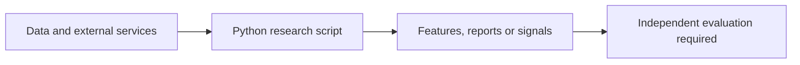

<div align="center">


**Macroeconomic proxy feature engineering for FX models**

[Architecture](#architecture) · [Code](#code-map) · [Run](#getting-started) · [Evidence](#evidence-and-limitations) · [Roadmap](#roadmap)

</div>

> **Status: Research prototype.** The contents of this repository are not evidence of production deployment, actual trading profit, or independently audited predictive performance. Legacy claims are archived in [docs/README_LEGACY.md](docs/README_LEGACY.md).

## Project purpose

Macroeconomic proxy feature engineering for FX models. This repository provides a starting point for reproducible investigations and independent review, not validated trading instructions.

| Property | Scope |
|:--|:--|
| Repository | [global_liquidity_dataminer](https://github.com/Shtenco/global_liquidity_dataminer) |
| Ecosystem | [SYNERGY SYSTEM](https://github.com/Shtenco/synergy_system) |
| Implementation | Single Python research program and documentation |
| Evaluation | Separate independent testing required |

## Architecture



This diagram describes processing responsibilities; it does not claim a verified live integration.

## Code map

| File | Role |
|:--|:--|
| [`global_liquidity_dataminer.py`](global_liquidity_dataminer.py) | Research implementation |
| [`README.md`](README.md) | Evidence-aware project overview |
| [`docs/README_LEGACY.md`](docs/README_LEGACY.md) | Archived source narrative and historical claims |
| [`assets/readme/hero.svg`](assets/readme/hero.svg) | Local SVG cover |

## Getting started

Use Python with the modules required by the script, plus a properly configured MT5 environment where required. This entry-point command is **not** a successful runtime-test claim.

```bash
git clone https://github.com/Shtenco/global_liquidity_dataminer.git
cd global_liquidity_dataminer
python global_liquidity_dataminer.py
```

Investigate missing imports, pinned dependencies and brokerage/data access before use. Never assume generated examples can safely place funded orders.

## Evidence and limitations

**Critical limitation:** Several central-bank-named inputs are FX proxies rather than central-bank balance-sheet series.

| Validation gate | State |
|:--|:--|
| Code visible in repository | Yes |
| Automated CI evidence | Not established in this documentation pass |
| Point-in-time dataset provenance | Not established |
| Strict out-of-sample result | Not established |
| Real-world risk-adjusted profitability | Not independently verified |

Backtests, synthetic signals and scenario forecasts must not be presented as realised market returns. Publication of a reproducible result requires data timestamps, versions, seeds, model configuration, execution costs and saved evaluation artifacts.

## Roadmap

1. Pin dependencies and document environment configuration.
2. Add source-data provenance and point-in-time integrity checks.
3. Introduce unit tests, baseline models and failure-mode tests.
4. Run strict walk-forward validation with transaction costs where appropriate.
5. Publish experiment manifests and independently reproducible evaluations.

## Attribution

Shtenco research portfolio. Licensing and reuse follow the repository's existing `LICENSE` file. Earlier narrative is preserved for historical context, not independently verified certification.
